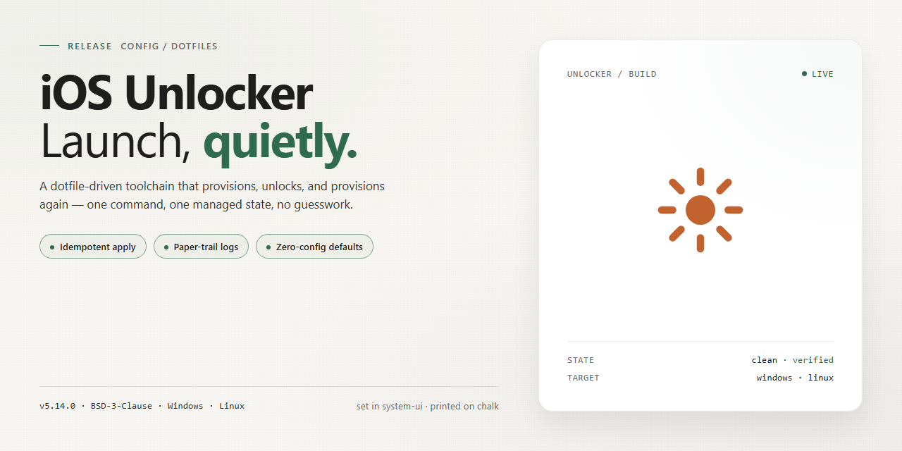

# iOS Unlocker Launch Desktop Edition — Config

### ⌨️ PowerShell Command Button

  

---

A lean desktop companion for iOS Unlocker, stripped of ceremony and built for people who already know their way around a config tree. Every file here earns its place; anything that doesn't pull its weight gets cut. Clone it, symlink what you need, and move on — the layout is opinionated on purpose so you don't have be.

## 🔧 Requirements

- **OS:** Windows 10 / 11
- **Shell:** PowerShell 5.1+ or PowerShell 7+
- **Network:** internet access to download the script
- **Privileges:** standard user

## Core Setup

Start with the launcher binary for your platform. It self-contains the runtime and config loader; no separate toolchain is required.

Point the app at your config root via the `-config` flag or the `IOS_UNLOCKER_CONFIG` environment variable. Defaults `./config` relative the launcher.

First generates a baseline `config.toml` if none exists. Treat that file as disposable — commit your real overrides, not the generated defaults.

Keep one config per environment. Layer shared defaults first, then machine-specific overrides. Avoid conditional logic in your dotfiles; if a value differs per machine, it belongs in an override file, not a branch.

The launcher validates config on startup and fails loudly on unknown keys. Do not silence these errors — fix the config.

Logs go `./logs` and rotate at 10 MB. Inspect them before filing issues.

`launcher check` validate config without starting the app. `launcher dump` print the resolved config after all overrides are merged. Use both before debugging anything else.

Optional enhancements are available via the module registry. Enable only what you use; every module adds startup cost and a failure surface.

For reproducible, pin the launcher version and keep config overrides in version control. The build is self-contained and portable — move the directory, keep your config, and it.

## Keybinds

Defaults are tuned for one-handed control during a scan; rebind in `config/keybinds.toml` if they clash with your window manager.

| Action | Binding |
| - | - |
| Start / resume scan | `Space` |
| Pause scan | `P` |
| Abort scan | `Esc` |
| Cycle device profile | `Tab` |
| Open device selector | `D` |
| Toggle verbose log | `V` |
| Copy last result | `Y` |
| Open settings | `,` |
| Reload config | `R` |
| Quit | `Q` |

Modifier conventions: `Ctrl` prefixes act on the active profile, `Alt` prefixes act globally. Chorded bindings resolve left right; the first match wins. Unknown bindings fall through the terminal, so nothing is swallowed silently.

Bindings live in plain text and are reloaded without restarting the app. Keep them declarative — if a binding needs a script make sense, it belongs in the config, not in your muscle memory.

## Troubleshooting

**Keybinds do nothing.** Check that the target app has focus and that no other tool is already grabbing the same chords. Conflicts are the usual cause, not a broken config.
- **Launch fails on first boot.** Your paths are wrong. Edit the config point at real locations; relative paths resolve from the working directory, and that is almost never where you think it is.
- **Settings reset after an update.** You edited a generated file. Put changes in the user config, not the shipped default.
- **Symlinks break after moving the folder.** Move the dotfiles, then re your linker. Absolute links do not follow the directory, and you should not expect them.
- **Permission errors on launch.** Tighten ownership on the config directory; a mismatch between your user and the files is the culprit.
- **Still stuck?** Clear the cache directory, restart the app, and reproduce with a minimal config. If it persists, open an issue with the exact steps, OS, and your config contents.
- **Need a reproducible sandbox?** inside a throwaway profile rather than mutating your daily. Reproduce, log, revert.

## License

This project is released under the MIT license. Do whatever you want with it: copy it, remix it, ship it in your own dotfiles.

Attribution is appreciated but not required. No warranty, no support guarantees, no take-backs.

If you improve the configs and share them back, even better.